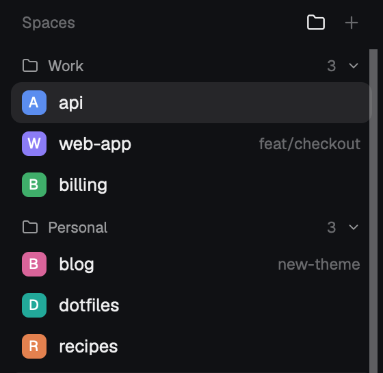

# herdr-folders

Folders for [Herdr](https://herdr.dev) spaces and agents. Put your spaces into
Work, Personal, or any folders you like, and group the agents list the same way.



## Install

```sh
git clone https://github.com/Bruno-Tome/herdr-folders
cd herdr-folders
cp -R mods/spaces-folders mods/agents-folders ~/.config/herdr-app/mods/
cp layouts/folders.json ~/.config/herdr-app/layouts/
herdr-app check ~/.config/herdr-app/mods/spaces-folders
herdr-app check ~/.config/herdr-app/mods/agents-folders
herdr-app do layout.switch '{"name":"folders"}'
```

Your own layout isn't changed: `ctrl-shift-l` switches back. To remove herdr-folders,
delete the copied files.

## Use

- **File a space:** drag it onto a folder header. To have it filed from the folder
  it's in, write rules (below).
- **Fold a folder:** click its header.
- **Folders on or off:** click the folder button next to + in the Spaces header. You
  can also bind a key in `~/.config/herdr-app/keys.json`:
  `"global": { "ctrl-shift-g": "spaces-folders.toggle" }`.
- **Agents by folder:** click the Agents sort button and pick **Grouped by folder**.

## Configure

Optional: `~/.config/herdr-app/folders.json` (see `folders.example.json`):

```json
{
  "folders": ["Work", "Personal", "Clients"],
  "rules": {
    "~/work": "Work",
    "~/code/personal": "Personal"
  }
}
```

The folders show in the order you list them. The longest matching rule wins, and a
space you dragged somewhere stays there. Everything else goes to Unsorted.
Changes apply within a few seconds.

## License

Apache-2.0. Both mods are modified copies of the `spaces` and `agents` mods that ship
with Herdr; see [NOTICE](NOTICE).
