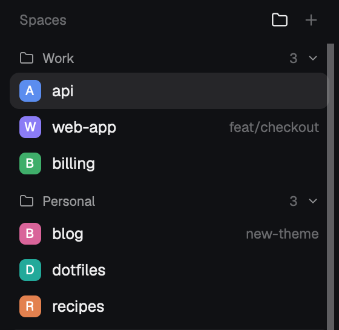

# Herdr with folders

Herdr's main layout, with spaces and agents sorted into folders such as Work and
Personal. The Spaces sidebar shows a header per folder, each with a count, that folds
on click. Drag a space onto a header to file it there, or let path rules file it for
you. The Agents list gets a "Grouped by folder" sort that uses the same folders.



## What you see

- **Left sidebar**, as in Herdr's `main`: the brand bar, Spaces on top, Agents below,
  Settings and Add machine at the bottom.
- **Spaces header:** "Spaces", then a folder button (14px icon in a 26px square) and
  the usual +. The folder icon is bright while folders are on. When they're off, it
  turns to a dim square. When `folders.json` doesn't parse, the error shows between
  the title and the buttons in the theme's `blocked` color.
- **Folder headers** (24px, 11px semibold, `muted`): a folder icon, the folder's name,
  how many spaces it holds (`dim`), and a chevron. Each folder's spaces follow,
  drawn exactly like Herdr's own rows: avatar, name, and repo, branch and
  ahead/behind where unusual. Worktree spaces stay nested under their checkout.
- **Unsorted** comes last with a square icon, and only while a space is in it.
- With more than one machine, each machine's block gets its own folders.
- **Agents, "Grouped by folder":** one header per folder ("Work 3"). Each row names
  its space, then its tab or title: "api · fix login".

## How it behaves

- **Choosing a folder:** a space someone dragged onto a folder header stays there.
  Otherwise the longest matching path rule in `folders.json` decides, using where
  the space's first terminal is now. Otherwise it's Unsorted. Dropping on Unsorted
  forgets the drag, so the rules decide again.
- **Dragging:** press a space and move over a folder header. The header lights up
  (`selected` background, 1px `accent` border) and the space dims to 50%. Releasing
  on a row still reorders, like Herdr's own drag.
- **Folding:** click a header to fold or unfold it. This is remembered per machine
  and folder.
- **On/off:** the folder button, or the key command `spaces-folders.toggle`, gives a
  flat list like Herdr's. Every window agrees, through shared `folders.spaces`.
- **Agents:** the sort button opens Priority, Grouped by space and Grouped by folder.
  Picking another sort is how you turn folders off there. Inside a folder, agents
  keep Herdr's order, so a space's agents stay together. Status marks (spinner,
  done dot, idle ring, "Needs you") are Herdr's.
- `folders.json` is read again every 5 seconds. Edits apply without a restart.

## Built from

- `layouts/folders.json`: Herdr's `main` with the `spaces` block on `spaces-folders`
  and the `agents` block on `agents-folders`.
- `mods/*/folders.js`, the same file in both mods: `loadConfig()` reads
  `appHome()/folders.json` (`readTextFile`), `folderOf(space, panes, config)`,
  `folderNames()`. Assignments are kept in shared `space.folders`
  (`{ spaceId: folderName }`).
- `mods/spaces-folders`: Herdr's `spaces` plus `foldered()`, which goes inside each
  machine block. It also adds the header toggle, `nextCommand()` "toggle", and
  localStorage `folders.folded`.
- `mods/agents-folders`: Herdr's `agents` plus the `folders` sort. It reads
  `spaces()` and `panes()` to find each agent's folder.
- Icons come from `mods/workspace-chrome/`: `folder.svg`, `square.svg` and the
  chevrons.
- It runs `git` the way Herdr's `spaces` does, and nothing else. No network.

## Config: `~/.config/herdr-app/folders.json` (optional)

```json
{ "folders": ["Work", "Personal"],
  "rules": { "~/work": "Work", "~/code/personal": "Personal" } }
```

Without the file you get Work and Personal, with no rules. Folder names match
case-insensitively. Renaming a folder sends the spaces dragged into it back to the
rules.

## Watch out

- The two mods are copies of Herdr 0.1.13's. Herdr's own updates won't reach them.
- `agents-folders` doesn't know about worktrees. A worktree space outside every rule
  shows in Unsorted there, even when Spaces nests it under a filed checkout.
- Rules match local paths. `~` is this computer's home, even for a space on another
  machine.
- Shared `agents.sort` is also used by Herdr's `agents`. With "folders" picked there,
  Herdr's own list falls back to Priority.

## Done when

- `herdr-app check` passes for both mods, and `layout.switch {name: "folders"}` shows
  folder headers in Spaces.
- A space under a rule's path appears in that folder. Dragging it onto another
  header moves it, and the move survives a restart.
- The folder button gives a flat list and brings the folders back.
- Agents sorted "Grouped by folder" shows the same folders as Spaces.
